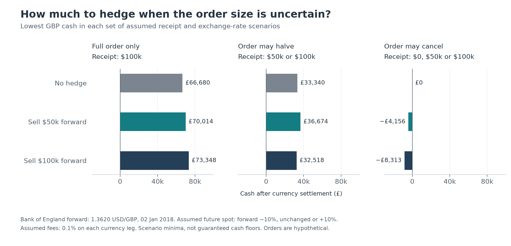
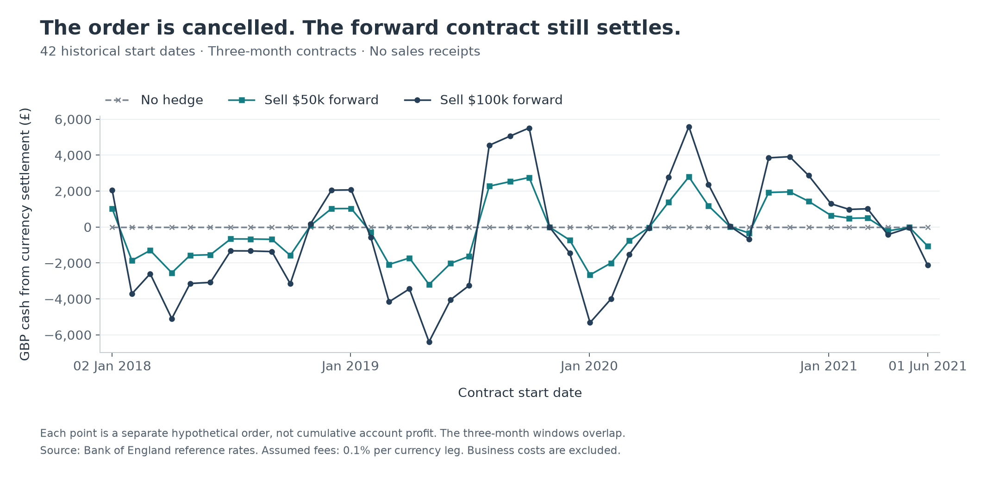

# FX hedging when an order changes

A UK exporter expects $100,000 in three months. How much should it lock at an agreed exchange rate if the customer might pay less or cancel?

This Python study combines Bank of England historical rates with hypothetical orders. **A forward can fix the exchange rate, but it cannot make the customer's payment arrive.** If the receipt is smaller than the contract, the missing dollars must be bought.

## Can both client requirements be met?

Suppose the client wants at least **£70,000 if the full order is paid**, and no more than **£3,000 lost if it is cancelled**. These are illustrative limits on currency cash, before business costs. Check contracts from $0 to $100,000, first in $10,000 steps and then in $5,000 steps.

Use the first available forward rate, 1.3620 dollars per pound on 2 January 2018. Future spot is assumed to be below, equal to, or above this rate by the stated shock. Costs apply to both currency legs.

| Shock / cost / cancellation loss limit | Passing hedges: $10k steps | Passing hedges: $5k steps |
|---|---|---|
| ±10% / 0.1% / £3,000 | None | None |
| ±10% / 0.1% / £5,000 | $50k, $60k | $50k, $55k, $60k |
| ±10% / 0.5% / £5,000 | None | $55k |
| ±15% / 0.1% / £5,000 | None | None |

The original limits conflict: on the $10k grid, meeting the receipt target requires at least $50k hedged, while the cancellation limit allows at most $30k. With a £5,000 loss limit, a $50,000 contract gives minimum full-order cash of **£70,014** and minimum cancelled-order cash of **−£4,156**.

The coarse grid misses a choice at the higher fee: $55k gives **£70,066** with the full order and **−£4,913** after cancellation, using each scenario's minimum. "No passing hedge" can mean the search is too coarse. Widening the FX shock to ±15% leaves no passing choice on either tested grid.

The same contract must pass both tests, although the two minima occur in separate order and exchange-rate scenarios. These are selected scenario minima, not guaranteed cash floors, probabilities or an optimal hedge. The next client discussion is about budget and loss tolerance.

The business question has a real counterpart: [Renishaw's 2025 annual report, p.155](https://www.renishaw.com/resourcecentre/en/download/annual-report-2025--144405), identifies changes in sales timing and reductions in highly probable forecast sales as possible causes of hedge ineffectiveness. This motivates the question; the client, limits and orders here are hypothetical.

The simpler comparison below shows how assumptions about reliable payment change the outcome of no hedge, a half hedge or a full hedge.



## What happened at historical rates?

The comparison covers **all 42 monthly starts from January 2018 to June 2021**. Each point is a separate three-month hypothetical order, with 0.1% assumed costs.



With no sales receipt and a $100,000 contract, cash ranged from **−£6,386 to +£5,586**. A remaining contract can create a gain or a loss. This is currency settlement cash, not company profit or a cumulative trading return.

## Follow the cash

Both rates are dollars per pound. R is the actual receipt, H the contracted dollars, F the agreed rate and S the maturity rate:

```text
contract cash = H / F
spot cash     = (R - H) / S
cost          = fee rate * (abs(contract cash) + abs(spot cash))
net cash      = contract cash + spot cash - cost
```

Example: a $100,000 contract at F=1.25 pays £80,000. If only $50,000 arrives and S=1.00, buying the missing dollars costs £50,000. Cash is £30,000 before fees, or £29,870 after 0.1% costs on both legs.

## How the question developed

1. Compare no hedge, half and full hedges using a cash ledger.
2. Reduce or cancel the order: a larger contract can create a dollar shortfall.
3. Set client limits before signing and check whether any contract meets both. Historical outcomes cannot identify the right contract in advance.
4. Repeat the search at smaller dollar steps: the first grid missed a feasible contract at the higher fee.

## Run it

Python 3.10 or later:

```sh
python -m pip install -r requirements.txt
python -m unittest test_analysis.py -v
python analysis.py
```

Read `settle()` first, then `client_constraints()` and `stress_summary()`. The script prints both scenario comparisons and recreates historical `results.csv` and both charts. The client test uses assumed future rates, not realised maturity rates.

Try one change: only $25,000 arrives despite an assumed $50,000 minimum. The $50,000 contract now requires buying another $25,000:

```python
from analysis import settle
print(settle(25_000, 50_000, 1.3620, 1.3620 * 0.90))
```

<details>
<summary>Data, checks and limitations</summary>

`rates.csv` is the unchanged [Bank of England export](https://www.bankofengland.co.uk/boeapps/database/_iadb-fromshowcolumns.asp?csv.x=yes&Datefrom=01/Jan/2018&Dateto=30/Sep/2021&SeriesCodes=XUDLUSS,XUDLGBD,XUDLDS3,XUDLDF3&CSVF=TT&UsingCodes=Y&VPD=Y&VFD=N), retrieved 15 October 2026. It has 949 daily rows, including 884 with both required rates. The code uses XUDLUSS (spot) and XUDLDS3 (three-month outright forward); other original columns remain intact.

The [forward series stopped after 1 July 2021](https://www.bankofengland.co.uk/boeapps/database/fromshowcolumns.asp?CSVF=TT&DAT=RNG&FD=1&FM=Jan&FNY=Y&FY=2021&Filter=N&FromSeries=1&SeriesCodes=XUDLDS3&TD=10&TM=Oct&TY=2026&ToSeries=50&Travel=NIxAZxSUx&UsingCodes=Y&VPD=Y&html.x=66&html.y=26&title=XUDLDS3), limiting the sample. Reference rates are not verified executable quotes; their bid/ask/mid convention has not been established here. [HSBC's forward explanation](https://www.business.hsbc.com/en-gb/products/fx-managing-currency-risk) provides product context.

Starts use the month's first available spot/forward pair. Maturity is three calendar months later, rolled to the next spot observation. This approximation omits spot lags and full banking calendars. Shifting the matched observation by ±1 or ±2 checks date sensitivity, not early close-out.

The CSV contains 42 starts × 9 receipt/hedge combinations × 3 fees × 5 date matches = 5,670 calculation rows. Windows overlap: these are not independent experiments. Existing `development` and `check` labels identify earlier/later starts; no hedge is fitted and no predictive performance is claimed. Both groups appear in the main chart.

For cancelled orders with $100,000 locked, across all 42 starts:

| Assumed cost | Original date cash range | Including ±2 observation shifts |
|---|---:|---:|
| 0% | −£6,228 to +£5,740 | −£6,398 to +£6,315 |
| 0.1% | −£6,386 to +£5,586 | −£6,556 to +£6,156 |
| 0.5% | −£7,020 to +£4,968 | −£7,190 to +£5,521 |

`gap_gbp` compares cash with the actual receipt converted at the starting forward rate, less the same fee. It separates currency effects from lost sales after the event; it is not an advance budget. `hedge_effect_gbp` compares with no hedge for the same order and dates. The old gap chart is retained in the local archive.

Tests cover hand-calculated cash, both conversion legs, dollar shortfalls, dates, exact client-limit boundaries and changes in feasible hedges. There is no daily margin, funding or operating-cost model. Fees are assumed, and a dollar shortfall is not itself an external financing requirement. Payment floors can fail; exchange rates can move beyond the chosen stress range.

</details>
